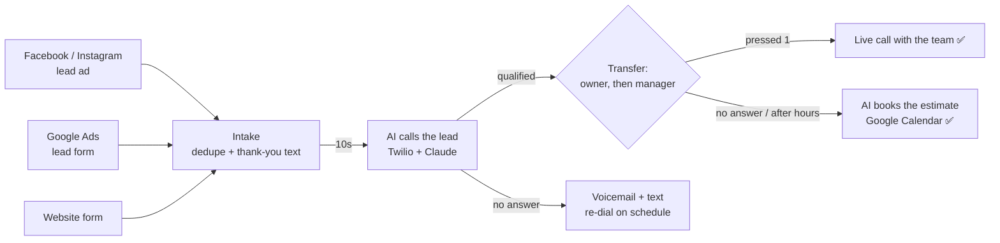

# Speed to Lead for contractors

When a homeowner fills out a contractor's **Facebook/Instagram lead ad**, **Google Ads lead form** or **website form**:

1. They see **"Thank you! Someone from our team will call you in just a moment."**
2. **10 seconds later** an AI appointment assistant calls them, confirms who they are, and collects what the team needs for the quote: the service they need, what's going on, the address, the timeline and any custom questions.
3. The AI **warm-transfers the call to the owner, then the manager**. Whoever picks up hears a 5-second summary and presses 1 to be connected.
4. **If nobody picks up** (or it's after hours), the AI comes back on the line and **books the estimate on the contractor's calendar**. The lead and the team each get a text confirmation.

Everything else a real speed-to-lead system needs is handled too: re-dials, voicemail drops, missed-call texts, callbacks at a time the lead picks, STOP/do-not-call, calling-hour rules, inbound callbacks answered by the AI, duplicate submissions, transcripts and summaries, and a dashboard.



## How it works

| Piece | What it does |
|---|---|
| `src/sources/` | Facebook Lead Ads webhook (+ one-click page connect), Google Ads lead-form webhook, website embed/webhook/hosted form |
| `src/leads/intake.ts` | Normalizes the lead, merges duplicates, texts "we're calling you now", queues the call for `callDelaySeconds` later (or for when calling hours open) |
| `src/jobs/queue.ts` | Durable SQLite job queue: calls, re-dials, callbacks, texts, webhooks survive restarts |
| `src/voice/dialer.ts` | Places the outbound call with answering-machine detection |
| `src/voice/session.ts` | The live AI conversation over Twilio **ConversationRelay**: streams Claude's reply into text-to-speech as it's written, handles barge-in, runs tools |
| `src/voice/tools.ts` | What the AI can do: `save_job_details`, `transfer_to_team`, `check_availability`, `book_appointment`, `end_call` |
| `src/voice/routes.ts` | Twilio webhooks: answer, status, voicemail detection, transfer with whisper + "press 1", fallback to booking, inbound calls & texts |
| `src/calendar/` | Google Calendar free/busy + event creation, slot finder (hours, buffers, notice, no double booking) |
| `src/admin/` | Password-protected dashboard: contractors, integrations, settings, leads, transcripts |

**The AI:** Claude (`claude-opus-5-5` by default) running at low effort for snappy phone replies, with Anthropic's server-side refusal fallback turned on (`ANTHROPIC_FALLBACKS=default`). Its first line ("Hi, this is Ava, Summit Roofing's virtual assistant. Am I speaking with Jane?") is a template, so the lead hears it the instant they say hello. Twilio handles speech-to-text and text-to-speech (ElevenLabs voices by default).

**Live transfer, step by step:** the AI says "Perfect, let me get Mike on the line" and hands the call back to Twilio. Twilio rings Mike from the contractor's lead line. When Mike answers he hears *"New Facebook lead for Summit Roofing: Jane Doe. Roof leak over the kitchen at 123 Main St, wants it fixed this week. Press 1 to talk to them now."* If he presses 1, the calls are bridged. If he doesn't (no answer, his voicemail picks up, he declines), the system tries the next person. If nobody accepts, the AI reconnects with the full conversation and books the appointment.

## Setup

You need:

- **Twilio**: one phone number per contractor (local area code = more pickups). In the Twilio console, enable ConversationRelay (it requires accepting the *Predictive and Generative AI/ML Features* addendum). For texting US numbers, register the numbers for **A2P 10DLC**.
- **Anthropic API key** for Claude.
- A server with HTTPS and a persistent disk (Railway, Render, Fly.io, a VPS…). Twilio, Meta and Google must be able to reach it.
- Optional: a **Meta app** (Facebook lead ads) and a **Google Cloud OAuth client** (calendar booking).

### 1. Configure and run

```bash
cp .env.example .env      # fill it in
npm install
npm run build && npm start   # or: npm run dev
```

Or with Docker (mount a volume at `/app/data` so the database survives deploys):

```bash
docker build -t speed-to-lead .
docker run -p 3000:3000 --env-file .env -v stl-data:/app/data speed-to-lead
```

Local testing: expose your machine with a tunnel (`ngrok http 3000`) and set `PUBLIC_BASE_URL` to the tunnel URL.

Open `https://<your server>/admin` and sign in with `ADMIN_USERNAME` / `ADMIN_PASSWORD`.

### 2. Add a contractor

**Add contractor**: enter the company name, time zone and their Twilio number. Then on their page:

1. **Settings**: services, service area, team members to transfer to (`Mike Johnson | Owner | +15125550100`, then the manager), office hours, booking hours, the questions the AI should ask, and company notes (pricing policy, financing, things never to say).
2. **Phone line**: click **Configure Twilio number** so callbacks to that number reach the AI and STOP replies are honored.
3. **Send a test lead** with your own cell. You should get a text instantly and a call 10 seconds later.

### 3. Connect the lead sources

**Website**: copy the snippet from the contractor page:

```html
<div data-speed-to-lead-form></div>
<script src="https://<server>/embed/<publicKey>.js" async></script>
```

It renders a mobile-friendly form with a call/text consent line and shows the thank-you message after submit. To keep an existing form, add `data-speed-to-lead` to its `<form>` tag instead. Form builders and Zapier can POST JSON or form fields to `/webhooks/website/<publicKey>`. There's also a hosted form page at `/f/<publicKey>`.

**Google Ads**: in the lead form asset, open **Export leads → Webhook integration** and paste the webhook URL and key from the contractor page. Set the form's *Submission message* to the thank-you text, then click **Send test data**.

**Facebook / Instagram lead ads** (one-time app setup):

1. Create a Meta app (type *Business*) at developers.facebook.com. Put its id and secret in `FACEBOOK_APP_ID` / `FACEBOOK_APP_SECRET`.
2. Add **Webhooks** → *Page* → callback URL `https://<server>/webhooks/facebook`, verify token = `FACEBOOK_VERIFY_TOKEN`, and subscribe to the `leadgen` field.
3. Add **Facebook Login for Business**, with valid OAuth redirect URI `https://<server>/oauth/facebook/callback`.
4. Request these permissions (App Review is needed before you use them for other businesses' pages): `leads_retrieval`, `pages_manage_metadata`, `pages_show_list`, `pages_read_engagement`, `pages_manage_ads`, `business_management`.
5. On each contractor's page, click **Connect a Facebook page** and pick their page. In their Business Settings → **Leads Access**, make sure your app is allowed.
6. In the Instant Form, set the **Completion** screen text to the thank-you message and add a consent disclaimer. Test it with Meta's *Lead Ads Testing Tool*.

**Google Calendar** (optional): in Google Cloud, enable the **Google Calendar API** and create an OAuth client (type *Web application*) with redirect URI `https://<server>/oauth/google/callback`. Put it in `GOOGLE_CLIENT_ID` / `GOOGLE_CLIENT_SECRET`, then click **Connect Google Calendar** on the contractor page. Without a calendar, the AI still offers times within booking hours and texts the team to confirm.

## Settings worth knowing

| Setting | Default | Notes |
|---|---|---|
| Call delay | 10s | Time between form submit and the AI call |
| Calling hours | daily 8am–9pm | Leads outside these hours are called when they open, and are told so by text |
| Transfer hours | Mon–Sat 8am–6pm | Outside them the AI books instead of transferring |
| Ring each person | 18s | Per team member during a transfer |
| Re-dial after | 2, 20, 240 min | One entry per retry. Each retry respects calling hours |
| Voicemail | first miss | Leaves a voicemail with the callback number on the first missed call |
| Merge repeat submissions | 30 min | Same phone across sources = one lead, one call |
| Webhook URL | – | Receives `lead.created`, `appointment.booked`, `lead.transferred`, `lead.unreachable`, `sms.received`, `call.completed` (with transcript) |

Model settings live in `.env`. `ANTHROPIC_MODEL` defaults to `claude-opus-5-5`. If you want even faster replies on the phone you can switch to `claude-sonnet-5-5` or `claude-haiku-5-5`, or raise `ANTHROPIC_EFFORT` to `medium` if the AI seems rushed.

## Compliance checklist

This is not legal advice. Have your own counsel review your setup.

- **Consent:** the FCC treats AI-generated voices as "artificial voice" under the TCPA, so you need the lead's prior express consent to call them with the AI. Every lead form (Meta disclaimer, Google form, website) should say they agree to calls and texts, including automated and AI calls. The website form includes this line by default.
- **Disclosure:** the AI introduces itself as the company's *virtual assistant* in its first sentence and answers honestly if asked whether it's a person.
- **Quiet hours:** keep calling hours inside 8am–9pm in the lead's time zone (the contractor's time zone is used).
- **Opt-outs:** "stop calling me" on a call and STOP by text both mark the lead do-not-call and cancel every queued call.
- **Recording:** calls are not recorded. Transcripts are stored for the dashboard. If you add recording, add a disclosure for two-party-consent states.

## Development

```bash
npm test          # 39 tests: lead sources, intake, scheduling, admin, and full call flows
npm run typecheck
npm run dev
```

The flow tests drive the real HTTP routes and a real WebSocket the same way Twilio does, with a scripted model and a fake phone carrier. They cover: form → call in 10s → qualify → transfer gets no answer → AI books on the calendar; owner presses 1; after-hours booking; barge-in; voicemail and re-dials; callbacks; do-not-call; STOP; and inbound callbacks. They also check that the Claude conversation history is append-only across the transfer hand-off.

## Limits & next steps

- Runs as **one instance**: live calls are held in memory and the database is a SQLite file. That handles a lot of contractors. Scaling out would mean Postgres plus sticky WebSocket routing.
- Calendars: Google Calendar today. Outlook, Calendly, Jobber, ServiceTitan or GoHighLevel would plug in behind `CalendarBackend` (`src/calendar/service.ts`).
- CRM sync goes through the outbound webhook (Zapier/Make) for now.
